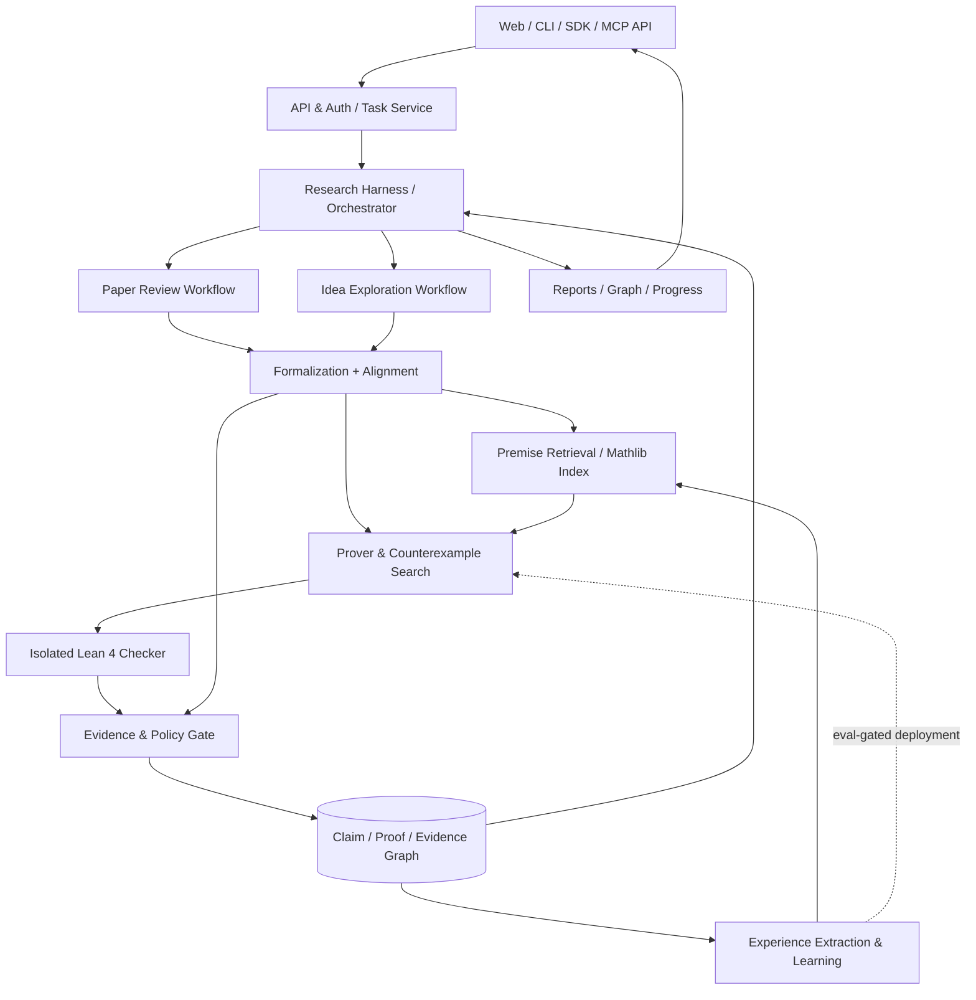
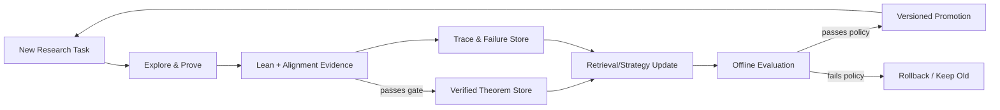

# 自我改进型形式化数学研究 Agent — 产品与工程实施蓝图

> **文档版本**：v0.1（可演进方案 / Living Design Document）  
> **编写日期**：2026-10-18  
> **读者**：项目发起人、Codex/其他编程 Agent、工程开发者、数学与形式化方法研究者  
> **当前状态**：设计假设与实施建议；**不是**已经验证的性能声明或固定技术选型  
> **产品代号**：Math Research Agent（MRA，暂定）  
> **一句话目标**：让数学研究想法和论文论证经过“AI 理解与探索 → 形式化命题 → Lean 检查 → 可信诊断 → 可复用积累”，逐步形成可交互、可审计、可扩展、可持续改进的数学研究平台。

---

## 0. 如何使用本文件

本文件既是项目需求说明（PRD），也是给 Codex 的初始技术上下文。它**有意避免过早锁死底座、模型、数据库、前端框架与训练方案**；对每个高风险决策给出可比较的选项、验收试验和决策记录（ADR）要求。

### 执行原则

1. **先证明最小技术闭环，再扩展功能**：优先实现一条真实自然语言命题的形式化、Lean 严格检查、结果说明和证据归档。
2. **保留商业化权利**：不能因为仓库公开就将代码直接复制到计划可能商业化的项目中；先核查许可证及模型权重、数据、图片、论文的独立许可。
3. **将“验证了什么”放在“验证成功”之前**：Lean 通过的是某个明确形式化命题；用户原意与该命题是否一致，需要独立检查或确认。
4. **证明失败 ≠ 命题错误**；不能用超时、编译失败或搜索失败充当数学反证。
5. **默认不信任 AI 的中间判断**：LLM 可提出候选命题/引理/证明，但不能独立赋予“Lean 已证明”的标签。
6. **可替换、可回放、可追溯**：模型、执行器、研究框架和验证器都经由稳定接口接入；每次任务能定位到输入版本、模型/工具版本、验证工件与依赖。
7. **以评估数据驱动演进**：是否引入新框架、训练或复杂多 Agent，取决于基准结果而非概念吸引力。
8. **未公开研究资料默认为私有**：原始论文、提示、证明记录和训练利用应区别授权、隔离存储并允许删除。

### 三类约束

- **必须满足（MUST）**：数学正确性门禁、结果状态语义、许可证合规、任务隔离、证据可追溯。
- **推荐满足（SHOULD）**：模块化架构、结果复现、结构化关系图、评估与可观测性。
- **可以延后（MAY）**：大型模型微调、分布式多 Agent、多人 SaaS、跨学科完整论文审稿。

本文所有技术栈与阶段时长均为**建议/假设，不是采购或实现承诺**。

---

## 1. 项目目标、边界与目标用户

### 1.1 产品定位

建设 **Self-Improving Formal Mathematical Research Agent**，服务于以下三类任务：

| 模式 | 用户输入 | 系统核心动作 | 输出形式 |
| --- | --- | --- | --- |
| **Paper Review** / 论文审稿 | PDF、LaTeX、定理/证明片段 | 提取命题与依赖、忠实形式化、逐步校验、查找缺口与反例 | 定理级/步骤级报告，定位到原文、证据链、验证等级 |
| **Idea Exploration** / 猜想探索 | 不严格的数学直觉、猜想、问题描述 | 澄清定义与假设、形式化候选命题、搜索证明/反例/必要引理 | “已证 / 已驳 / 缺口 / 未知 / 待澄清”等结构化结论 |
| **Knowledge & Improvement** / 知识与能力积累 | 经验证的定理、证明状态与历史探索 | 入库、检索、经验提炼、评估、可选持续训练 | 可复用数学知识库与实证的能力提升 |

### 1.2 典型用户

- 数学研究生与研究人员：检查已有论证、探索尚未明确的猜想。
- 计算机科学/形式化方法研究人员：验证算法性质，沉淀可复用引理。
- 教师和学生：理解证明为何缺少必要条件；**教学辅助**而非成绩评判的唯一依据。
- 研究团队：共享经过授权的定理、证明记录、验证报告。
- 后续商业用户（可选）：研究机构私有部署、企业算法验证、按项目付费的论文审查服务。

### 1.3 非目标（至少在第一阶段）

- 保证自动验证任意数学论文的所有结论。
- 对所有开放数学难题给出确定的真/假判定。
- 单靠 Lean 判断论文新颖性、科研价值或引用可靠性。
- 让模型无限制改写自身内核、放宽公理政策或绕过验证器。
- 将未授权用户论文自动上传至公共知识库或用于训练。
- 对用户做出“整篇论文已被完全形式化认证”的未经限定的宣传。

### 1.4 用户可感知的最小价值

MVP 的目标是演示：用户输入一条清晰命题，系统展示**确切被检查的形式化陈述**、检查结果、必要条件、相关证明与依赖，并可明确说明“尚无法确定”——而非总是生成一个确定答案。

---

## 2. 已有项目研究与选型原则

### 2.1 Euler：重要参考，但不是预设的唯一核心

候选仓库：<https://github.com/canghaimeng/Euler>

依据 2026-10-18 查阅的仓库文档和代码，Euler 包含：

- 共享结构化数学研究状态、证明路线/依赖图、Fact Graph、失败记录与研究前沿（frontier）。
- 多 Agent 协作、CLI/MCP gateway、按角色限制的事实提交、可恢复的研究里程碑。
- 默认独立 LLM 证明审阅及事实验收机制。
- **已经存在真实 Lean Kernel Check 相关代码**，如 `euler/control/kernel_service.py` 和 `kernel_evidence.py`，包含检查记录、依赖指纹、证明资源归档和命题对齐的设计。
- 浏览器工作台和研究者交互模块，可作为早期 UI/交互范例。

**需要特别纠正的认识**：Euler 并非“只有 AI 审稿、完全没有 Lean”——其代码中已经有形式化检查能力；但**默认 LLM 审阅与 Lean 证明证据不是同一可信等级**，不能直接视作全部 Fact 都经过 Lean 严格证明。

**许可红线**：Euler 原创代码及修改采用 **PolyForm Noncommercial 1.0.0**。这不等同于 MIT/Apache 的可商业使用许可。就商业化而言：

- 非商业研究原型：在明确符合许可证条件时，可以尝试 fork、修改或内部使用。
- 准备收费 SaaS、商用 SDK、收费企业私有部署：**不能默认直接使用/改编 Euler 原创代码**；需要授权，或采用独立商业兼容实现。
- 不可认为“只要把 Euler 作为外部服务独立部署”就自动规避其商业使用限制；具体使用方式及授权需逐项判断。
- Euler 涉及上游 Apache-2.0 材料与自身非商业修改，两者的权利不能混淆；不同文件可能有不同许可。

参考：[Euler 中文架构](https://github.com/canghaimeng/Euler/blob/main/ARCHITECTURE.zh.md)、[验证与信任](https://github.com/canghaimeng/Euler/blob/main/docs/security-and-trust.zh.md)、[许可说明](https://github.com/canghaimeng/Euler/blob/main/LICENSING.zh.md)。

### 2.2 可替代/可组合的技术

| 项目 | 仓库 | 候选用途 | 截至核查时的许可提示 | 待核查事项 |
| --- | --- | --- | --- | --- |
| **Euler** | https://github.com/canghaimeng/Euler | 研究编排、证明图、事实图、工作台 | **PolyForm Noncommercial**（原创部分） | 商用授权、版本成熟度、代码复用界线 |
| **Danus** | https://github.com/frenzymath/Danus | Fact Graph 多 Agent 架构备选 | 仓库显示 Apache-2.0 | 子模块/第三方依赖独立许可 |
| **Lean 4** | https://github.com/leanprover/lean4 | 可信形式化证明引擎 | Apache-2.0 | 固定工具链版本与证明依赖 |
| **Mathlib4** | https://github.com/leanprover-community/mathlib4 | 形式化数学知识基础 | Apache-2.0 | 对应 Lean 版本、特定内容来源 |
| **LeanDojo-v2** | https://github.com/lean-dojo/LeanDojo-v2 | Lean 环境交互、轨迹、训练/检索 | 仓库声明 MIT | 实际接口/依赖兼容与部署开销 |
| **PyPantograph** | https://github.com/stanford-centaur/PyPantograph | 程序化 Lean 目标/战术交互 | **需查看确切许可证文件** | Lean 版本兼容、资源安全、稳定性 |
| **ProofFlow** | https://github.com/Huawei-AI4Math/ProofFlow | 依赖图驱动自然语言证明形式化 | 仓库显示 MIT | 对长论文的能力、模型依赖与限制 |
| **LeanAgent** | https://github.com/lean-dojo/LeanAgent | 持续检索训练、跨仓库学习参考 | **待逐文件确认许可** | 老版本 Lean 兼容、与 v2 关系 |
| **DeepSeek-Prover-V2** | https://github.com/deepseek-ai/DeepSeek-Prover-V2 | 专用证明生成模型候选 | **权重/代码许可需分别核查** | 使用限制、推理成本、模型服务要求 |
| **Goedel-Prover-V2** | https://github.com/Goedel-LM/Goedel-Prover-V2 | 专用证明生成模型备选 | **权重与代码独立审查** | 版本锁定、性能、硬件成本 |

> 本表仅是初步筛选，不是法律意见。**许可应以实际采用的仓库 commit、文件、模型 checkpoint、数据集条款为准**。合规账本需保存查询日期、链接、SPDX/许可证文本摘要、适用范围和审批记录。禁止因上表的“候选”标识直接视作已经可用于商业部署。

### 2.3 两条商业化兼容路线（暂不提前决定）

**路线 A — Euler 扩展实验（研究优先）**

- 目标：最快评估 Euler 现有研究图、编排、证据流水线的价值。
- 条件：当前活动属于许可允许的非商业范围；所有改编遵守要求。
- 方法：独立 fork 或本地实验工程，优先使用插件/Adapter 接入 Lean 自动形式化与任务 API。
- 未来商用：获得作者正式授权，或进入路线 B 的商业兼容重构；不要假设重构过程可以复制受限原创实现。

**路线 B — 商业兼容独立核心（推荐作为长期可选项）**

- 目标：项目自己的任务、证据、知识和验证边界由独立代码控制。
- 参考成熟概念：Euler 的研究状态与依赖图思想；**避免未经授权复制其受限代码或特定实现**。
- 实现选择：从零设计，或按许可审计后选择 Danus（Apache-2.0）等可商用组件；形式化部分优先 Lean4/Mathlib/ProofFlow/LeanDojo-v2 的适配器。
- 好处：商业化路径灵活、模型和研究引擎可替换、功能标准可控。
- 成本：需要自建 Agent 调度、事件记录及图谱状态管理。

**路线 C — 授权后复用 Euler**

- 在得到明确商用授权时，将 Euler 作为编排内核并在周边开发；注意授权范围、版本升级、再分发及服务部署条款。

**建议**：第 0 阶段先完成“许可 + 能力”双重 Spike 再决策；Harness 的业务接口不应依赖 Euler 内部数据结构。

---

## 3. 不变的数学可信性原则（关键）

### 3.1 五类对外结果（与系统错误分开）

1. `PROVED`：已证明——明确的**形式化命题**已通过符合政策的 Lean 检查，且与用户意图的对齐具有可说明的依据。
2. `REFUTED`：已反驳——已发现经严格验证、确实满足原命题假设并违反其结论的反例，或已证明形式化命题的否定。**有限数值试验仅算候选反例**。
3. `GAP_FOUND`：有待解决的理论缺口——存在具体未证明的中间义务/缺失条件，尚不能断言命题为假。
4. `UNKNOWN`：未确定——证据不足；包括搜索耗尽预算、证明空间过大、当前工具能力不足。
5. `NEEDS_CLARIFICATION`：待澄清——自然语言中的术语、量词、边界或假设含糊，尚不能合理正式化。

系统/执行故障另以 `EXECUTION_ERROR`、`TIMEOUT`、`CANCELLED`、`POLICY_BLOCKED` 等 **运行状态** 报告；不要混到数学判断里面。

> **命题为真** 与 **原论文证明正确** 是两个不同的问题。审稿需分别给出 `claim_verdict` 与 `author_proof_verdict`，不允许一个字段兼任两者。

### 3.2 证据等级与“晋升”规则

| 证据级别 | 含义 | 是否可标记为 Lean 严格证明 | 是否可进入严格可信定理索引 |
| --- | --- | --- | --- |
| `E0_CANDIDATE` | 模型生成的命题/证明/猜测 | 否 | 否 |
| `E1_LLM_REVIEWED` | LLM/多 Agent 审查通过 | 否 | 否 |
| `E2_FORMALIZED` | 已生成明确 Lean 陈述，但证明未完成 | 否 | 否 |
| `E3_KERNEL_CHECKED` | Lean 已通过且证据政策满足 | **仅限该形式化命题** | 先进入隔离待对齐库 |
| `E4_ALIGNED_AND_VERIFIED` | E3 + 原文/意图语义对齐获得可审计确认 | 是，但需披露依赖与假设 | 是，审核去重与来源后 |

- `E3` ≠ `E4`：Lean 内核不会自动证明“AI 对用户中文意图的翻译是对的”。
- `E1` 不能直接升级为 `E3`；必须运行真实形式化证明检查。
- 确认验证等级时核查**实际命题、证明对象、外加公理、占位、被跳过的目标及信任例外**。禁止以“文件编译了”替代完整证明检查。
- 审查 `sorry`/`admit`/`sorryAx`、新增公理、依赖的可信性以及项目政策允许的计算原语；实施应按 Lean 语义和环境查询，而不只依赖字符串正则。
- 采用版本化公理白名单与策略：默认允许 Lean 常见基础公理（如经典数学需要的基础原则），但**禁止用户/模型偷偷注入不受许可的附加公理**。具体策略与基础库兼容性由形式化专家审核。
- 如果自动化采用特殊可信执行机制，需保留其额外信任假设或切换更严格的复验路径。
- 任何新的定理如果依赖已撤销或有缺陷的前提，必须级联降低/撤销其可信等级。

### 3.3 “错误定位”必须有明确证据

论文中一条证明步骤 Lean 无法完成，可能因为：

- 数学逻辑确实有漏洞；
- 证明跳过了已知但尚未形式化的中间步骤；
- 形式化陈述错误/歧义；
- Mathlib 缺少对应定理；
- 自动证明器策略能力不足；
- 运行超时或执行环境失败。

对外报告必须标记诊断类型与可信度，避免把“未完成证明”宣传成“作者数学错误”。对于“命题不成立”，优先提供 Lean 核验的反例；对于“证明方法存在缺口”，报告**最小未闭合义务、原文位置、缺失假设和使用的推导依据**。

---

## 4. 推荐逻辑架构（与技术产品解耦）



### 4.1 推荐模块边界

| 模块 | 唯一职责 | 不应该做什么 |
| --- | --- | --- |
| `api` | HTTP/MCP/CLI 协议、输入验证、认证鉴权 | 直接决定数学命题真假 |
| `tasks` / `harness` | 调度、状态机、重试、资源预算、日志/回放 | 直接相信未验证的模型答案 |
| `document_ingestion` | PDF/LaTeX/Markdown 解析、引用映射与版面坐标 | 自动宣告论文正确 |
| `claim_graph` | 记录命题、假设、证明步骤、依赖、原文锚点 | 无依据地合并不同数学命题 |
| `formalization` | 生成 Lean 陈述候选、记录语义对齐与歧义 | 将编译通过当作语义等价 |
| `retrieval` | Mathlib、内部定理与外部论文检索 | 直接成为可信事实来源 |
| `prover` | 证明搜索、拆分目标、反馈修复 | 绕过独立验证器 |
| `refuter` | 搜索/形式化反例或命题的否定 | 将随机数值测试当作严格反驳 |
| `lean_checker` | 隔离环境检查真实 Lean 证明 | 接受外部伪造的 PASS 标记 |
| `evidence_policy` | 证据分级、命题对齐、公理政策、入库/撤销 | 依赖模型自报检查通过 |
| `knowledge` | 已验证定理、证明经验与版本化检索索引 | 不经审核直接写入 Mathlib 官方库 |
| `learning` | 训练集生成、检索策略训练、离线评测、模型发布 | 直接线上自修改且无回滚 |
| `reporting` | 解释结果、链接原文与证据、可视化 | 省略不确定性与失败原因 |

### 4.2 适配器（Adapter）协议

不要把应用层直接写死到 Euler 或任何指定供应商。约定接口（示意）：

- `ResearchEngine`: `create_research`, `plan`, `dispatch`, `resume`, `get_frontier`, `get_graph`。
- `Formalizer`: `formalize_claim`, `formalize_step`, `suggest_clarifications`。
- `PremiseRetriever`: `retrieve(query, environment_pin, corpus_scope)`。
- `ProofGenerator`: `propose_proof(goal, premises, budget, prior_feedback)`。
- `LeanExecutionBackend`: `check(project_snapshot, target, policy)`, `interact(goal, tactic)`。
- `CounterexampleBackend`: `search_candidate`, `formal_verify_candidate`。
- `EvidenceGate`: `assess`, `promote`, `revoke`, `cascade_invalidate`。
- `ExperienceStore`: `append_trace`, `query_similar`, `export_trainset`。
- `LearningBackend`: `train_retriever`, `train_policy`, `evaluate`, `publish_if_passed`。

首期接口可以只是 Python Protocol + 类型化 DTO；不需要为了“插件架构”提前建设复杂微服务发现系统。

### 4.3 物理部署的渐进选择

- **单机研发**：Python 进程 + SQLite/文件工件 + 隔离 Lean 子进程（适合功能验证）。
- **内部多用户 Alpha**：FastAPI + PostgreSQL + Job Queue/Worker + 对象存储（按需）。
- **商业 SaaS**：独立 API、任务队列、无网络/最小权限的 Lean Worker、租户隔离、审计与计费。

注意：证明检查可能消耗大量 CPU/内存，属于异步长任务；API 接收任务后应返回任务 ID，前端通过轮询/SSE/WebSocket 获取进度。研究执行可以在后端异步，**不得把未完成任务的结果宣称为完成**。

---

## 5. 用户流程 A：Idea / 猜想探索

### 5.1 逐阶段处理

1. **用户提交 Idea**：自然语言描述、所属领域、已知条件、希望验证的结论，可选附上自己的草稿。
2. **命题澄清**：识别量词、对象类型、边界、隐含条件、符号歧义；必要时给出 1–3 个候选数学表述，请用户确认。
3. **粗筛**：检索 Mathlib、现有内部已验证库、相关文献，辨识已知结果或直接反例方向。
4. **建立研究计划**：主命题 → 子目标/引理 → 假设依赖 DAG，区分事实/猜想/工具反馈。
5. **双向探索**：并行或按成本策略执行 `prove` 与 `refute`；先采用低成本启发式，再升级到高成本证明器。
6. **形式化候选**：将精确命题和证明候选转换为 Lean 4，固定版本的 Mathlib 环境。
7. **Lean 检查**：核查实际目标、所有未闭合目标、额外公理/占位、资源消耗及运行结果。
8. **语义对齐**：确认用户原陈述与形式化陈述之间的映射；首版建议采用显式用户确认。
9. **生成结果**：五类数学判断之一 + 证据等级 + 对原始假设和搜索预算的说明。
10. **入库**：仅符合政策的已验证对象可进入可信知识层；失败轨迹可以进入非可信经验层。

### 5.2 示例输出（产品层面的结构，不是实时验证）

输入：“所有有界实数数列都收敛。”

- 数学判断：`REFUTED`（假设已形式化验证某反例）。
- 反例描述：`(-1)^n` 有界但不收敛。
- 证据：反例满足有界性与不收敛性的 Lean 检查工件。
- 形式化目标：展示实际被检查的命题。
- 附加说明：与“存在收敛子列”的正确命题不同，不可混用。

如果只运行了数值测试，没有验证，应该标成“**候选反例**”，数学判断为 `UNKNOWN`/`GAP_FOUND`（按语义）。

### 5.3 后续可拓展能力

- 用户补充条件后自动创建命题分支，保留旧版本与依赖关系。
- 类比已知定理、发现最弱必要假设（仅输出经过审查的建议）。
- 对多条候选路线评分并管理搜索预算。
- 新颖性检索报告与形式化正确性报告分开。

---

## 6. 用户流程 B：论文审稿 / 证明级辅助评估

### 6.1 输入范围与递进支持

- MVP：论文中单一定理 + 作者提供的证明文字/LaTeX。
- 第二阶段：LaTeX 项目或结构清楚的文本 PDF。
- 第三阶段：整篇 PDF，包含跨章节引用、符号表、证明依赖关系。
- 扫描版 PDF、复杂图形证明、外部非形式化文献引用、前沿高等数学：允许明确标注“需要人工处理”。

### 6.2 流程设计

1. **解析源材料**：抽取正文、公式、定义、定理、引理、脚注和引用；保留页码、段落、公式锚点、原文件哈希。
2. **范围识别**：作者在哪个数学结构/假设下工作？明确适用范围、记号、依赖引理。
3. **原文证明图**：把作者每个关键步骤拆成可审查的推导义务，保留作者原步骤顺序与前提。
4. **形式化语义校准**：生成形式化候选并检视是否弱化/强化结论、改变假设或偷偷修复原作者错误。
5. **双通道验证**：
   - **原证明忠实通道**：仅检查作者真正提供的推理与可补全的显然步骤，不能悄悄替换错误论证。
   - **定理独立探索通道**：允许使用其他证明或反例，不代表作者原证明有效。
6. **诊断分型**：数学反例、缺失前提、无效引用、未闭合引理、自动化不足、解析/形式化错误、外部依赖未验证。
7. **定位与报告**：标示原文页码/公式/定理编号、图谱节点、具体义务、已尝试的修复与其额外假设。
8. **人工复核**：对“论文存在实质性错误”之类高影响结论要求强化证据、人工确认或显式注明未确认。

### 6.3 审稿报告输出字段

- `paper_id`, `paper_version`, `source_hash`, `scope`。
- `theorem_id`, `original_statement`, `formal_statement`, `alignment_status`。
- `author_proof_status` 与 `claim_status`（分开）。
- `step_id`, `source_location`, `assumptions`, `dependencies`, `check_status`。
- `finding_type`、`severity`、`confidence`、`formal_evidence_ids`。
- `suggested_repair`、`repair_requires_new_assumptions`。
- `limitations`、`unverified_references`、`execution_budget`。

### 6.4 高价值典型情况

- 论文证明步骤缺少连续性或可积性条件：指出条件缺口，而不是立刻断言定理为假。
- 论文证明步骤错误，但另一条 Lean 验证的独立证明可成立：**作者证明有缺陷 / 命题仍可成立**。
- 论文结论在给定假设下有经验证的反例：**命题被驳斥**，附反例与形式化范围。
- 形式化失败：报告“无法完成验证及原因”，不得虚构逻辑错误位置。

### 6.5 防止“偷偷修正作者原证明”

审稿系统至少应保存原文本步骤和 AI 重写步骤的并排差异：

- 是否引入作者没有使用的新假设？
- 是否将弱命题改成强命题或反之？
- 是否遗漏量词、定义域或例外情形？
- 是否直接引用了待证明目标造成循环依赖？
- 是否用别的证明取代作者原本的推理？若是，应归属于“独立定理证明”，而非“原证明认证”。

此问题应作为独立核心指标 `faithfulness_rate` 评估。

---

## 7. RSI：分层持续改进，而非无边界自我修改

这里 RSI 作为“研究系统在可靠反馈下持续改善自身能力”的工程目标，不预设必须进行昂贵的在线大模型训练。

### 7.1 三层演进

**L1 — 经验证的数学知识积累（优先）**

- 新定理/证明通过证据门禁后保存至**自有版本化 Lean 库**，不自动提交 Mathlib 上游。
- 记录可重现证明：工具链 commit、Mathlib commit、Lean 源文件、声明及公理依赖、来源、审查记录。
- 检索时按命题范围、学科、证明依赖、语言描述、相似性等检索。
- 需要防止等价命题重复、错误扩大适用范围及撤销传播。

**L2 — 证明经验与策略积累（推荐）**

- 保存真实证明状态、实际采取的动作、Lean 反馈、目标变化、失败/成功耗时与模型配置。
- 提炼可检索的任务分解经验、引理选择、失败模式，而非将 AI 的“自述思维链”当作真实轨迹。
- 改善检索排序、示例选择、证明策略选择及预算分配。

**L3 — 受控的模型/检索器学习（后续）**

- 对通过许可与隐私审批的数据进行 SFT、检索器训练或基于形式化反馈的 RL。
- 用固定回归集 + 时间隔离/仓库隔离/难度隔离的新问题集进行评测。
- 只有新增能力达标且旧能力未明显退化，才发布新模型；保持回滚与 A/B 比较。

### 7.2 RSI 的系统闭环



### 7.3 训练数据分级

- `public_permitted`：许可允许的公开 Mathlib/基准（仍需记录数据集许可及使用条件）。
- `project_owned`：本人项目生成并有明确权利的证明数据。
- `user_opt_in`：用户明确同意用于训练的私有内容。
- `private_no_train`：默认用户上传内容；只能用于指定项目推理与结果保存。
- `restricted`：禁止训练/共享的受限材料。

训练流水线应默认**拒绝**未知权限数据，不允许“缺少许可字段就视作公开”。

### 7.4 自我改进的客观证据

- 新问题 `solve_rate`、`verified_rate`、平均 tokens/秒数/计算成本。
- 定理检索 `Recall@k`、`MRR`。
- 新领域跨仓库性能 vs 旧领域保持率（遗忘）。
- 错误诊断准确率与过度自信率。
- 同一预算下的增量提升（排除仅靠更长搜索或更大模型的伪提升）。
- 在完全未用于训练、难题选择和人工调参的 **held-out** 集合上测试。

### 7.5 质量门禁示意

训练后的新版本只有在如下条件下才能推广：

1. 没有新增跨租户数据泄漏；
2. 证明检查的严格性不降低；
3. 在固定成本预算下至少一项预先声明的主要指标提升；
4. 对已有基线集合的退化在预先声明的可接受区间内；
5. 相关人工质检案例无严重回归；
6. 能一键回滚到前一版本。

上述具体数值阈值由实测基线后在 ADR 中决定，不先拍脑袋。

---

## 8. 核心数据模型（建议规范）

不要求首版完整实现，但需要定义稳定身份与证据关系。

### 8.1 主要实体

| 实体 | 关键字段 | 说明 |
| --- | --- | --- |
| `User` / `Tenant` | id、role、data_policy | 商业部署需要，单机 MVP 可简化 |
| `Project` | id、owner、visibility、settings、version | 某次长期研究的容器 |
| `SourceDocument` | id、hash、mime、storage_key、license、provenance | 原文与权限管理 |
| `SourceAnchor` | document_id、page、section、span、latex_range | 将结论定位回原稿 |
| `Claim` | id、NL statement、scope、assumptions、version、status | 精确数学命题；不同假设视作不同版本 |
| `FormalizationCandidate` | claim_id、Lean statement、model、alignment_report | 一个自然语言命题可以有多个形式化候选 |
| `ProofObligation` | claim_id、subgoal、parents、deps、status | 证明依赖图节点 |
| `ProofAttempt` | goal_id、model、trace、budget、result | 一个目标可有多轮独立探索 |
| `ProofArtifact` | source_hash、theorem_name、environment_pin、axioms、checker_output | 可复核证明工件 |
| `Evidence` | subject_id、kind、level、checker、attestation、timestamp | 证据等级与来源 |
| `Finding` | source_anchor、category、severity、supporting_evidence | 审稿中的具体问题 |
| `KnowledgeItem` | claim_id、proof_id、trust_level、scope、dependencies | 自有知识库对象 |
| `LearningExample` | provenance、consent、quality、split、trace | 可用于训练/评测的样本 |
| `EvaluationRun` | dataset_version、model_version、metrics、cost、decision | 改进前后可比较 |
| `AuditEvent` | actor、action、object_id、before/after、time | 入库/撤销/变更等审计 |

### 8.2 基础不变量

- `Claim` 的**范围/假设/结论**更改必须产生新版本，旧证据不能默默迁移。
- 证明关系图中“推理依赖”与“研究尝试”分开；前者必须拒绝未经支持的循环依赖。
- `Evidence` 一经发出不可就地修改；更新产生新证据或撤销事件。
- `ProofArtifact` 与 `environment_pin` 一起计算内容哈希，防止新旧版本混淆。
- `SourceDocument` 在删除后触发其派生私有缓存清理策略；若存在授权保留的匿名化评估数据，应显式记录。
- `KnowledgeItem` 必须记录出处、公理/许可/审查与依赖；撤销依赖时级联失效。
- `E3/E4` 状态只由 `EvidenceGate` 授予；LLM 与普通 Agent 没有直接写可信状态的权限。

### 8.3 示例事件（数据契约示意）

```json
{
  "event_type": "proof.kernel_check.completed",
  "schema_version": "1",
  "project_id": "prj_demo",
  "claim_version_id": "claim_demo_v2",
  "attempt_id": "att_demo",
  "lean_environment": {
    "lean_toolchain": "<pinned-lean-toolchain>",
    "mathlib_commit": "<pinned-git-sha>"
  },
  "verification": {
    "engine": "lean4",
    "status": "PASS",
    "formal_statement_hash": "<sha256>",
    "proof_source_hash": "<sha256>",
    "axiom_audit": "PASSED_BY_POLICY",
    "artifact_uri": "internal://artifacts/att_demo"
  },
  "alignment": {
    "status": "PENDING_REVIEW",
    "reviewer": null
  },
  "trust_level": "E3_KERNEL_CHECKED"
}
```

这是**结构示意**，不是已确定的公开 API；应随首个实际实现及类型验证调整。

---

## 9. Harness 与 API 设计

### 9.1 Harness 的定义

Harness 不是另一个大语言模型，而是 Agent 工作的**受控执行环境**，包含：任务生命周期、工具路由、模型抽象、预算管理、证据检查、日志、检索/记忆、状态恢复及评估。

建议尽可能“一个核心，多种入口”：

- `CLI`：方便本地调试、批量评估与 Codex 调用。
- `HTTP API`：供 Web 前端或其他系统集成。
- `MCP Tools`：供外部 Agent 以受限工具方式调用（后续）。
- 可选 `SDK`：用于内部研究自动化。

### 9.2 候选接口（不锁死 REST/GraphQL）

| 接口 | 行为 | 返回 |
| --- | --- | --- |
| `POST /v1/projects` | 创建研究项目 | project_id |
| `POST /v1/ideas` | 提交猜想/idea | task_id、clarification_required |
| `POST /v1/reviews` | 提交论文/定理审稿任务 | review_id、task_id |
| `POST /v1/documents` | 上传文档并返回引用 ID | document_id |
| `GET /v1/tasks/{id}` | 获取运行状态、预算、当前阶段 | state、progress、error |
| `GET /v1/tasks/{id}/events` | SSE/轮询查看进度事件 | events |
| `POST /v1/tasks/{id}/cancel` | 取消任务 | 状态确认 |
| `GET /v1/claims/{id}` | 命题、候选形式化及版本 | claim object |
| `POST /v1/claims/{id}/confirm-alignment` | 确认自然语言/形式化对齐 | alignment attestation |
| `GET /v1/reports/{id}` | 结构化报告与导出链接 | report |
| `GET /v1/evidence/{id}` | 检索校验工件与可信等级 | evidence |
| `GET /v1/knowledge/search` | 检索已验证知识 | provenance-rich results |
| `GET /v1/evals` | 获取模型/策略评测结果 | eval runs |

### 9.3 状态机建议

`CREATED → QUEUED → RUNNING → (WAITING_FOR_USER | COMPLETED | FAILED | CANCELLED)`。

其中 `COMPLETED` 只意味着任务执行结束，**不意味着数学证明成功**。数学结果由独立 `math_verdict` 字段体现。

任务应支持：

- 幂等请求 ID（防止重复扣费/重复证明）。
- 重试策略（基础设施错误可重试、形式化歧义不应盲目重试）。
- 阶段性 checkpoint、用户取消和预算超限。
- 工具调用日志、模型版本与使用额度记录。
- 通过策略控制每个阶段最高 token/时间/并行度/Lean 执行预算。

### 9.4 给外部 Agent 的最小 MCP 能力

建议初期只提供：`formalize_math_claim`、`prove_or_refute_claim`、`get_proof_status`、`retrieve_verified_lemma`、`inspect_evidence`。

不要允许外部 Agent 直接传一个自称 `PASS` 的 JSON 来写入可信知识库；证据必须由内部 verifier 计算与签发。

---

## 10. Web 原型的建议产品体验

### 10.1 信息架构

1. **Workspace 首页**：历史研究项目、当前任务、资源使用与权限。
2. **Idea 工作台**：自然语言 Idea 输入 → 澄清问题 → 正式命题 → 验证进度 → 结果/反例/缺口。
3. **Paper Review 工作台**：上传、论文结构、定理清单、审稿报告与原文对应位置。
4. **Proof Graph**：依赖关系、各子目标状态、证据按钮、断点和缺口。
5. **Verified Library**：内部已验证命题、版本、依赖、来源和再验证操作。
6. **Experiments / RSI**：模型/检索器版本、评估曲线、数据权限和发布记录（管理员/研究人员可见）。

### 10.2 核心交互

- **有解释的状态**：`PROVED`、`REFUTED`、`GAP_FOUND`、`UNKNOWN`、`NEEDS_CLARIFICATION` 不混淆。
- **原文与形式化并排**：用户可查看被证明的实际命题，避免被“验证通过”的标语误导。
- **可跳转的证据链**：从审稿发现 → 原文位置 → 依赖节点 → Lean 工件。
- **用户可干预**：修改假设、确认形式化、指定待审稿定理、继续某条证明路线。
- **显示范围和代价**：任务预算、用时、是否只审查部分论文、模型版本。
- **私有默认**：共享、训练许可、公开定理入库必须单独操作。

### 10.3 前端路线选择

- 原型 P0：复用 Euler 工作台（**仅非商业合规实验**）或轻量 Streamlit/Gradio（快速评估体验）。
- 产品 P1：React/Next.js + 类型化 API + 数学公式显示 + 图谱可视化。
- 不建议首日就引入复杂协同编辑、多人权限或高成本实时渲染。

---

## 11. 参考仓库组织方式（非固定）

建议保留 `core` 与 `adapters` 分界，未来替换 Euler/模型/数据库时不重写全部业务逻辑。

```text
math-research-agent/
├── README.md
├── LICENSE                  # 必须根据自有代码/依赖实际权利确定
├── docs/
│   ├── product/             # 本蓝图、用户流程、验收标准
│   ├── adr/                 # 架构决策记录
│   ├── security/            # 数据、许可证、执行隔离
│   └── evaluation/          # 数据集说明与评估协议
├── apps/
│   ├── api/                 # HTTP 服务
│   ├── web/                 # 可选独立 Web 前端
│   └── cli/                 # 调试/批处理命令
├── packages/
│   ├── domain/              # Claim / Evidence / Task 数据模型
│   ├── orchestration/       # Harness 状态机、预算与路由
│   ├── ingestion/           # PDF/LaTeX/文本解析
│   ├── formalization/       # NL -> Lean + alignment
│   ├── proving/             # 证明搜索/反例搜索
│   ├── verifier/            # Lean 检查与公理/证据门禁
│   ├── knowledge/           # 版本化定理/证明图
│   ├── learning/            # 经验、训练、评估与晋升
│   └── adapters/
│       ├── research_engines/ # Euler(若授权)/Danus/own
│       ├── lean/            # LeanDojo/Pantograph/native CLI
│       ├── llm/             # 云 API / 本地模型
│       └── storage/         # SQLite/PostgreSQL/对象存储
├── lean_workspace/          # 固定版本与自有形式化定理库
├── tests/
│   ├── unit/
│   ├── integration/
│   ├── security/
│   ├── golden_math/
│   └── e2e/
├── evals/
│   ├── datasets_manifest/
│   ├── baselines/
│   └── reports/
├── ops/
│   ├── docker/
│   ├── scripts/
│   └── monitoring/
└── .env.example             # 只提交示例，永不提交真实密钥
```

实现语言方面，**Python 是推荐的初始后端语言**（现有 Euler、ProofFlow、LeanDojo 等生态较便于组合）；前端和后台运行队列/存储根据首轮 Spike 结果再定。

---

## 12. 首轮 MVP 的明确边界与验收

### 12.1 MVP-0：技术风险清除

目标：明确底座与许可证，跑通真正的 Lean 证明执行。

- 核查 Euler、Danus、LeanDojo-v2、ProofFlow、Pantograph、模型权重及数据许可。
- 在隔离环境成功启动 Lean 4 + 固定 Mathlib；保存版本号和构建清单。
- 验证至少一条已知真实命题、一个明确错误命题的反例/否定、一个含证明占位的非法“成功”案例。
- 对比 Euler 复用、Danus 改造和自有最小核心的工作量。
- 产出 `docs/adr/0001-research-engine.md`、`docs/security/license-inventory.md` 和技术 Spike 结果。

**退出条件**：有可复现的真实 Lean 检查脚本 + 明确的商业许可风险结论 + 可运行测试。

### 12.2 MVP-1：Idea 可信验证闭环（建议先交付）

最小闭环：

`Input → clarify → formalize → user review/confirm → proof or counterexample search → Lean check → evidence classification → report → optional knowledge write`

**必须具备**：

- 命题澄清和至少一个形式化候选版本。
- Lean 检查工件与工具链版本固定。
- 无占位/附加未授权公理的检查与证据门禁。
- `PROVED`、`REFUTED`、`UNKNOWN`、`NEEDS_CLARIFICATION` 及系统错误分流；`GAP_FOUND` 可先采用较简单的未闭合子目标表示。
- 至少一条支持用户复核的证明轨迹。
- 基础 CLI/HTTP 接口 + 最轻量的 UI 或测试页面。

**不要求**：证明任意数学竞赛题、微调专用模型、全面 PDF 解析、多租户 SaaS。

### 12.3 MVP-2：定理片段级论文审稿

- 支持从用户提供的 LaTeX/文本提取一个定理及其证明。
- 证明依赖图可视化，报告明确区分“作者原证明”和“命题独立验证”。
- 精确指出至少部分预制缺口案例的原文位置/假设。
- 面对错误/不确定形式化应有 `UNKNOWN`/`NEEDS_CLARIFICATION` 反馈。
- 能将步骤与原文锚点互相跳转。

### 12.4 MVP-3：分层 RSI（先做知识，再做学习）

- 版本化存储已通过门禁的 Lean 定理。
- 记录真实 Lean 轨迹与失败反馈。
- 检索知识对重复/相似问题产生实测收益。
- 用旧模型/新策略做隔离评估，保存报告。
- 等有数据支持再进行 LoRA/SFT/RL，而不是预先将训练当作必须完成项。

---

## 13. 测试策略与质量指标

### 13.1 黄金测试用例（第一周就建设）

| 测试组 | 场景 | 正确行为 |
| --- | --- | --- |
| A | 已知简单真命题 | 能生成并复核 Lean 证明；显示实际形式化语句 |
| B | 错误全称命题且有具体反例 | 只有反例经形式化验证后才标 `REFUTED` |
| C | 命题为真，但用户给出的证明有漏洞 | `author_proof_verdict` 反映缺口，`claim_verdict` 可另行证明 |
| D | 用户语言歧义，假设缺失 | `NEEDS_CLARIFICATION`，不偷偷增加假设 |
| E | 证明搜索超时 | 数学判断 `UNKNOWN`，运行状态 `TIMEOUT` |
| F | Lean 代码含 `sorry`/违规公理/开放目标 | 拒绝严格 `PROVED` 标签 |
| G | Lean 证明了被弱化/篡改后的命题 | 对齐未通过，拒绝 `E4` |
| H | 外部引理尚未被检查 | 标记未验证依赖，禁止作为严格可信前提 |
| I | 相同输入重复提交 | 幂等、可追溯，避免不必要重复执行 |
| J | 用户恶意 PDF/提示注入 | 输入作为非可信资料处理，无权调用敏感系统工具 |
| K | Lean/Mathlib 版本变更 | 旧证据保留版本，必要时要求重新检查 |
| L | 删除/撤销一个基础事实 | 所有依赖该事实的可信结论被标记失效或待复审 |
| M | 上传受限未发表论文 | 不进入公开训练/共享库，无用户许可不外传 |
| N | AI 自述“Lean 已通过”但实际验证失败 | 以真实 checker 工件为准，拒绝晋升 |

### 13.2 指标建议

**数学可靠性**：

- `verified_claim_rate`：在固定预算和固定测试集上真正通过形式化检查的比例。
- `alignment_accuracy`：用户意图和形式化命题的人工标注对齐准确率。
- `false_proved_rate`：实际不应验证通过的案例中系统误报 `PROVED` 的比例（核心安全指标）。
- `counterexample_soundness`：反例满足前提并否定结论的严格正确率。
- `gap_localization_precision/recall`：真实证明错误的定位效果。
- `calibration`：系统对未知/不确定问题是否克制，不虚构结论。

**产品与工程**：

- 命题处理端到端成功率、P50/P95 响应时间、每任务成本、复现率、失败/取消率。
- 工具调用故障率、缓存命中率、训练数据许可通过率。
- 同一数学领域与跨领域的新任务能力增长以及旧任务保持率。

### 13.3 评测原则

- 公开 benchmark 可用 miniF2F、PutnamBench 等，但需严格核查各自许可证与版本，防止训练/评测泄漏。
- **不能仅报告 Pass@k**：必须一并报告 k/预算、证明合法性、原问题对齐、重复样本剔除和模型成本。
- 自建“错误证明审稿”数据集：包含缺失条件、循环论证、错误定理应用、真定理假证明、真实反例、正确证明、不可判定的未完成案例。
- 每项高影响审稿结论最好由受训数学审阅者形成标注标准，并允许复审争议。

---

## 14. 商业化准备、许可、安全与隐私

### 14.1 许可证管理是进入开发前的 Gate 0

建立软件物料清单（SBOM）/许可清单：

| 字段 | 内容 |
| --- | --- |
| dependency | 仓库/包/模型/数据集/论文资产名称 |
| pinned_version | 实际 commit/tag/checkpoint |
| license | 原始许可证全文链接和摘要 |
| scope | 代码、模型权重、数据、文档、素材的适用范围 |
| intended_use | 非商业实验、公开开源、收费 SaaS、企业部署等 |
| compatibility_decision | approved / restricted / needs legal review |
| attribution | 通知和署名义务 |
| reviewer / reviewed_at | 核查人和日期 |

尤其注意：

1. **Euler PolyForm Noncommercial**：不可默认纳入商业产品的代码依赖。
2. **模型文件不是一定跟代码同许可**：例如 DeepSeek-Prover 的模型许可文件可能包含特定用途限制；不同 checkpoint 的许可证也可能不同。
3. **外部数学论文的原文**：访问不等于获得公开转发/训练的权利。
4. **Mathlib 的代码许可**不自动覆盖用户上传材料、第三方论文和模型输出中的所有素材。
5. 上线商业服务前，应由有资质的法律人员核对最终授权条款及实际商业模式。

### 14.2 安全威胁模型

**非可信输入**：PDF/LaTeX、用户消息、Mathlib 注释、第三方网页、模型生成的 Lean 源、第三方 API 响应。

至少防御：

- Prompt injection：论文中的“忽略之前命令”应视作论文内容，不得成为系统指令。
- 任意命令执行：LLM 不直接获得宿主机 shell、真实密钥或任意文件系统权限。
- Lean 资源耗尽：限制 CPU、内存、时间、进程数、磁盘，worker 与 API 隔离。
- 网络外泄：Lean 执行器默认禁出网，必要依赖预拉取且版本固定。
- 文件路径穿越、恶意归档文件、符号链接逃逸、跨租户数据读取。
- 混淆证据：外部提供的 PASS、伪造 checker 日志、旧版本证明不可直接采信。
- 模型/检索器训练污染：受限资料不可擅自混入公共训练集。

### 14.3 隐私与商业部署建议

- 默认私有项目；账户与租户隔离；可选零保留或自定义保留策略。
- 明确用户是否同意用论文/反馈训练；默认未同意。
- 对外部 LLM 的发送权限可按项目配置；敏感场景优先支持私有模型或明确告知外发。
- 文件内容加密、密钥管理、访问审计、删除与导出能力按部署等级逐步完善。
- 对高价值/未发表论文，支持私有化部署作为长期商业方向。

---

## 15. 研究与商业价值、差异化路线

现有研究已覆盖 Lean 证明搜索、自然语言形式化、依赖图及持续学习的部分技术。产品差异化不应仅是“把几个 GitHub repo 组合”。

### 候选差异化

1. **原论证忠实型审稿**：错误到底在作者哪条推理链？系统给出证据，不只输出一个新证明。
2. **对不确定性的正确表达**：把错误、搜索失败、形式化偏差、理论缺口明确分开。
3. **端到端可审计的研究记录**：从用户原文到严格 Lean 工件、版本和依赖关系可以回放。
4. **版本化数学知识与学习闭环**：不仅有库，还能量化“经过哪些任务后、为什么能力提升”。
5. **商用兼容、可私有部署的数学验证 Harness**：可作为其他科研 Agent 的可信验证后端。

### 后续商业模式（非现在必须决定）

- 研究室/高校的项目订阅与私有部署。
- 面向企业算法验证的专业服务。
- 对研究团队提供托管知识库、审计记录和协作。
- API/MCP 按任务/资源计费的验证后端。

需要通过真实用户访谈验证付费意愿；不要在 MVP 前构建复杂账单系统。

---

## 16. 架构决策记录（ADR）与开放问题

所有重大技术选型先保存 `docs/adr/*.md`，记录**问题、选项、依据、实验、决策日期、回滚方式**。

| ADR | 待决策问题 | 可选方案 | 推荐决定时机 |
| --- | --- | --- | --- |
| ADR-001 | 研究引擎采用什么？ | Euler 授权复用 / Danus / 自有小型 orchestrator / 混合 | MVP-0 |
| ADR-002 | Lean 执行接口？ | 原生 CLI/Lake / PyPantograph / LeanDojo-v2 | MVP-0 实测 |
| ADR-003 | 数学 LLM 组合？ | 通用 API / 专用证明模型 / 混合 | MVP-1 基准后 |
| ADR-004 | 证据与对齐政策？ | 自动+人工/不同信任级别 | MVP-1 前 |
| ADR-005 | 存储？ | SQLite+文件 / PostgreSQL+对象存储 / 图数据库 | MVP-1 数据量测后 |
| ADR-006 | 文档解析入口？ | 先 LaTeX / 混合 PDF+LaTeX | MVP-2 |
| ADR-007 | 前端？ | 现成 Euler Dashboard（合规）/ 快速原型 / 独立 Web | MVP-1/2 |
| ADR-008 | 首个专注数学领域？ | 数论 / 线性代数 / 基础分析 / 图论 | 用户测试前 |
| ADR-009 | RSI 何时引入训练？ | 先检索经验 / 增量检索训练 / 全模型微调 | MVP-3 |
| ADR-010 | 发布模式？ | 本地 / 单租户托管 / 商业多租户 | 付费试点前 |

### 需要由实验回答的具体问题

- Euler 的现成研究状态是否明显优于自有最小任务状态机？
- 将 ProofFlow 接入以后，形式化忠实度在真实论文证明上是否足够？
- 可调用通用推理模型 vs 本地形式化专用模型，在同样预算下哪种更划算？
- 对于首期数学领域，Mathlib 的覆盖是否足够？
- 自动命题对齐能做到什么水平，何时必须人类确认？
- RSI 的提升来自知识检索、搜索策略还是模型参数更新？
- 哪些审稿错误类型能达到足以公开演示的低误报水平？

---

## 17. 建议的阶段计划与退出门槛

> 时间只用于资源规划；没有基础实验前不承诺日历交付日期。每一阶段必须通过验收才能扩大范围。

| 阶段 | 目标 | 主要产物 | 不通过时的后备方案 |
| --- | --- | --- | --- |
| **P0** 技术/许可 Spike | 选择商用可行底座、验证真实 Lean 检查 | 许可账本、ADR、可复现测试 | 放弃强依赖 Euler，缩小为自有核心 |
| **P1** Idea MVP | 自然语言命题 → 形式化 → Lean → 报告 | CLI/API/简单 UI、证据工件 | 使用人工确认命题/只支持有限领域 |
| **P2** 审稿片段 | 单定理及其作者证明检查 | 依赖 DAG、原文定位、诊断报告 | 先仅支持 LaTeX/Markdown |
| **P3** 知识复用 | 入库/检索/撤销/版本管理 | Verified Library、经验存储 | 先用本地文件+SQLite |
| **P4** RSI 实验 | 可证实的持续改进 | 训练/评测管线、回滚记录 | 如果未提升，仅保留检索增强 |
| **P5** Web/部署 | 内部用户试用与产品迭代 | 安全 Web、权限、监控 | 单租户/本地部署先行 |

**阶段依赖并非完全串行**：简单网页可在 P1 同时做；论文解析技术 Spike 也可在 P1 期间平行探索。但“商业化部署”和“自动模型训练”不应跳过各自验证门禁。

---

## 18. 给 Codex 的执行规则（非常重要）

Codex 读取本文件后，不要立刻把所有功能写成一个大工程。遵循以下迭代工作法。

### 18.1 第一次任务（先审计、后设计）

1. 阅读本文件并列出“不变量 / P0 / P1 / P2+”。
2. 检查当前工作目录的真实代码与依赖，不要假设仓库结构与文档完全一致。
3. 比较 Euler、Danus、自有最小核心的架构适配度与许可；标记商业化冲突。
4. 实际检查 Lean/Mathlib、ProofFlow、LeanDojo-v2/Pantograph 的安装与最低运行样例（工具不支持时如实记录）。
5. 生成 `docs/adr/` 的初始决策草案、首期任务清单、风险清单与验收矩阵。
6. **先提交一个小、可运行、可测试的 vertical slice**，不要同时实现 PDF、训练和全套 Web。

### 18.2 开发时的默认规则

- 不得把 Euler 非商业原创实现混入可能商用的核心模块，除非事先确认授权。
- 所有第三方库必须经过许可清单、版本固定和安全评估。
- 任何 `PROVED` / `REFUTED` 都需有真正的验证工件；模型自报不足以晋升。
- 训练数据有 `license`、`consent`、`provenance`、`split` 字段。
- 公理/占位/声明范围改变时证据要失效或需要重新审查。
- 每个 PR 说明：所做变更、测试、已知限制、是否影响证据政策或许可。
- 测试中混用 mock 与真实 Lean 时必须显式标注；mock 只能证明协议正确，不能证明数学可靠性。
- 遇到两种可行方案，优先写比较实验、定义退出条件，不因本文件某处的示例选型而强制选择。

### 18.3 第一组可拆分的工程 Issue

| ID | Issue | 最小完成定义 |
| --- | --- | --- |
| `MRA-001` | 建仓库与质量门禁 | 目录/README/CI/格式检查/单测通道可运行 |
| `MRA-002` | 授权与依赖盘点 | 形成可审计许可清单，明确 Euler 商用路径 |
| `MRA-003` | Lean 4 固定环境 | 可复现成功/失败/占位非法三个案例 |
| `MRA-004` | 核心 Domain Schema | Task/Claim/Artifact/Evidence 有类型与版本测试 |
| `MRA-005` | Evidence Gate | 伪造 PASS、错误版本、违规公理都无法晋升 |
| `MRA-006` | ResearchEngine Adapter | 自有最小引擎或一种框架适配器可替换 |
| `MRA-007` | Formalizer Interface | 输出候选命题、歧义清单、对齐状态 |
| `MRA-008` | Prover + Lean Bridge | 在固定预算下提交候选并取得真实检查输出 |
| `MRA-009` | Idea CLI/API | 至少一个完整纵向流程、可查询任务状态 |
| `MRA-010` | 基线评估 | 固定黄金样例、报告实际成功率与失败类型 |
| `MRA-011` | Proof DAG 与锚点 | 单定理的逐步论证结构及证据关联 |
| `MRA-012` | Review Report | 真命题假证明等案例可区分、可导出 |
| `MRA-013` | Knowledge Store | 已验证证据入库、检索、依赖撤销测试 |
| `MRA-014` | Learning Experiment | 在独立数据集上比较静态/更新策略 |
| `MRA-015` | Web UI 与隔离部署 | 可以上传/查看结果，权限和安全测试通过 |

### 18.4 禁止的“伪完成”

- 展示通过按钮，但后端只让 LLM 回答“验证完成”。
- Lean 文件包含 `sorry` 或新增未许可公理，却标成严格已证明。
- 把用户输入自动改成更弱的命题、证明更弱结论后对用户说原猜想成立。
- 论文关键步骤失败时直接报告“作者错误”，但没有排除形式化器/检索器能力不足。
- 收集所有用户论文自动用于训练，而没有独立授权。
- 将 Mock 任务跑通声称完成真实数学验证。
- 在商业核心中复制受限仓库代码，而只通过改名规避许可。

---

## 19. 可直接粘贴给 Codex 的起始任务

> 以下文字可作为 Codex 的第一轮任务指令；当有本地仓库时，把本文件放在仓库 `docs/product/blueprint.md`（或等价位置）。

```text
你是本项目的首席工程实现助手。请阅读 docs/product/blueprint.md，目标是构建
可商业化选项不受不必要限制的“Lean 形式化数学研究 Agent”最小可运行系统。

第一轮请不要实现全部功能，也不要直接决定必须使用 Euler。

请先完成：
1. 调查当前项目源码及第三方仓库的真实版本、许可证、接口与运行条件；
2. 对比 (A) Euler 非商业研究路线、(B) Danus/商用兼容开源方案、
   (C) 自研最小 Orchestrator 三条路线，用实测可行性/复用成本/许可/维护风险评分；
3. 形成 docs/adr/0001-research-engine.md 与 docs/security/license-inventory.md；
4. 做一个真正调用 Lean 4 的 P0 纵向实验，验证简单真命题、错误命题反例、
   以及含证明占位/违规公理的拒绝案例，固定工具链并保存证据；
5. 定义 Task/Claim/Formalization/Evidence 的最小类型与测试；
6. 输出后续 5~10 个按优先级排序的 Issue，并说明每项验收方法。

约束：
- 不能把 LLM 审阅当作 Lean kernel 证明；
- 不得未授权复制/用于商业目的的 Euler 非商业原创代码；
- 所有不确定项明确列为 TODO / ADR，不要伪称已经验证；
- 可以修改具体技术栈，但要以可复现测试与客观比较为依据；
- 每完成一步运行实际测试并报告结果。
```

### 第二轮建议指令（仅在 P0 通过后）

```text
现在开始 P1 Idea Verification MVP。请先实现一条真实的纵向流程：
NL 猜想 -> 歧义/量词检查 -> 候选 Lean 命题 -> 用户确认/对齐记录 ->
证明或反例搜索 -> Lean 实际检查 -> Evidence Gate -> 可查询任务报告。
优先设计接口与黄金测试，不训练新模型，不实现全论文 PDF，不搭建复杂 SaaS。
完成后提交真实通过和真实失败的 Lean 日志与系统限制说明。
```

---

## 20. 参考资料及核对入口（2026-10-18）

### 工程仓库

- Euler: <https://github.com/canghaimeng/Euler>
- Euler 架构: <https://github.com/canghaimeng/Euler/blob/main/ARCHITECTURE.zh.md>
- Euler 许可说明: <https://github.com/canghaimeng/Euler/blob/main/LICENSING.zh.md>
- Euler 安全与信任: <https://github.com/canghaimeng/Euler/blob/main/docs/security-and-trust.zh.md>
- Danus: <https://github.com/frenzymath/Danus>
- Lean 4: <https://github.com/leanprover/lean4>
- Mathlib 4: <https://github.com/leanprover-community/mathlib4>
- LeanDojo-v2: <https://github.com/lean-dojo/LeanDojo-v2>
- PyPantograph: <https://github.com/stanford-centaur/PyPantograph>
- ProofFlow: <https://github.com/Huawei-AI4Math/ProofFlow>
- LeanAgent: <https://github.com/lean-dojo/LeanAgent>
- DeepSeek-Prover-V2: <https://github.com/deepseek-ai/DeepSeek-Prover-V2>
- Goedel-Prover-V2: <https://github.com/Goedel-LM/Goedel-Prover-V2>

### 研究/评测方向

- ProofFlow — Dependency Graph Approach to Faithful Proof Autoformalization: <https://arxiv.org/abs/2510.15981>
- LeanAgent — Lifelong Learning for Formal Theorem Proving: <https://arxiv.org/abs/2410.06209>
- miniF2F-v2: <https://github.com/roozbeh-yz/miniF2F_v2>
- PutnamBench: <https://github.com/trishullab/PutnamBench>
- Lean 4 官方: <https://lean-lang.org/>

> 参考资料仅供技术比较，**不要认为所有项目的声明、性能与许可证在将来都不会变化**。Codex 采用代码前应重新检查实际 commit、license、issue 和兼容性。对于论文报告性能，区分论文基准结果与本项目实测结果。

---

## 21. 简明路线图（决策摘要）

**当前推荐默认路线：**

1. **先完成许可证与运行 Spike**：Euler 是高度相关的参考实现，但不让其非商业许可证成为未来商业化的不可控依赖。
2. **项目自有 Harness 接口**：任务、命题、证据、验证等级和数学结果状态由自己控制；Euler/Danus/自研编排可以互换。
3. **第一项核心能力 = Idea 的真实 Lean 验证闭环**：先做正确性与可审计性，再增加 PDF、复杂审稿和训练。
4. **论文审稿要“双通道”**：作者原证明的忠实核查，与最终命题独立证明/反驳明确分离。
5. **RSI 按 L1 → L2 → L3**：先数学知识，再真实证明经验，最后受控模型训练；每次升级必须有实测收益。
6. **Web 是一层用户入口，不等于 Agent 内核**：原型可轻量，长期保持 CLI/API/MCP 共同调用同一 Harness。
7. **整个产品以可信边界为核心**：不可由 LLM 单独宣布严格证明成功；用户最终可以打开、核对、复现其结果。

**下一个实际动作**：将本文件交给 Codex，先执行第 19 节的第一轮任务，得到第一个可运行 P0 纵向实验，再根据结果进行首次架构修订（v0.2）。
