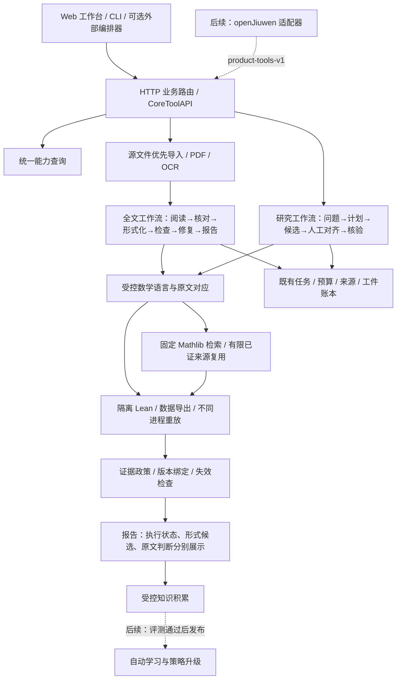

# 产品框架总览与交付顺序

更新：2026-11-02。采用单机模块化架构：先让已有模块通过稳定合同协作，再按需要拆服务。这里区分已运行的产品代码、受限能力和后续目标；接口存在不算数学能力完成。

## 整体构造

实线表示已有模块之间的主要调用关系，仍受下表范围限制；虚线是尚未完成的产品能力。图中“全文”指已提取文字处理链，不表示整篇论文已获数学认证。

## 分层与当前边界

| 层 | 当前代码与职责 | 当前边界 |
| --- | --- | --- |
| 产品入口 | `http_api.py`、各领域 `*_web.py`、`core_tools.py`、`mra/web/` | 本机工作台与 CLI；28个本地 JSON 工具。尚无多用户认证。 |
| 能力发现 | `workflows.py`，`GET /v1/capabilities`，`workflow.capabilities` | 查询当前工作流、模型配置、语言入口和缺口；环境文件存在不等于运行环境已验证。 |
| 来源与版本 | `document_intake.py`、`document_extract.py`、`document_obligations.py` | HTML/TeX 优先，PDF 文本和英文 OCR 兜底；来源修订会使相关旧任务过期。 |
| 全文执行 | `paper_automation.py`、`paper_pipeline.py`、`paper_budget.py` | 持久任务、阅读拆分、逐项核对、目标锁定、有限修复、预算结算及显式恢复；实际模型效果尚未验收。 |
| 研究执行 | `research_studio.py`、`research_protocol.py`、领域研究 store | 领域中立的问题与计划，受控后端核验；外部模型候选来源合同仍待补。 |
| 形式化与模型 | `paper_protocol.py`、`paper_alignment.py`、`model_service.py`、`paper_models.py` | 原文与 AST 对应，供应商无关接口；受限语言，模型核对不代替人工语义认证。 |
| 检索与复用 | `premise_search.py`、`mathlib_knowledge.py`、`proof_library.py` 等 | 固定来源检索与部分真实证明复用；检索命中本身不是证明。 |
| 验证与证据 | `paper_kernel.py`、`verifier.py`、`replay.py`、`evidence.py` 及领域门禁 | 真实 Lean、不同进程重放和工件检查；只在已支持范围工作。 |
| 评测与发布 | `ops/scripts/run_tests.py`、`tests/suites.json`、既有评测模块与 CI | 软件合同、环境延后、真实检查和模型效果分开；自动训练和升级回滚闭环尚未交付。 |

全文自动链目前使用 `typed / calculus / proof2` 三种 profile。研究工作台的后端键为 `typed / calculus / pde / proof`；它们是不同业务合同，不能仅凭名称自动互换。

## 这一轮交付

1. 补齐统一能力查询，页面 HTTP 与外部本地工具可读取同一份能力描述。
2. 将文档导入和全文创建、查询、工件读取、取消、恢复接入原工具门面；研究任务可创建并保存原问题起始计划。
3. 沿用现有权威状态与证据，不新增队列或迁移旧任务；默认关闭工具写入权限。
4. 验证幂等、错误回执、源版本漂移、旧任务恢复和大文件限额。

使用方式与参数见[业务工具协议](../protocols/core-tools-v1.md)。源码调用查询不创建任务，也不启动服务。

## 接下来的三个交付

| 顺序 | 交付 | 可验收标准 |
| --- | --- | --- |
| 1 | 研究候选来源与规划合同 | 人工、项目内模型和外部编排器产物有独立来源记录；外部提交不能冒充人工；完整源版本、假设和预算保留；能够送到现有真实验证。 |
| 2 | 数学后端的统一能力与预查合同 | 各后端明确可表达对象、量词、策略、环境采用状态及不支持原因；新增领域无需修改全文调度状态机；不能通过降级题目绕过限制。 |
| 3 | 固定任务端到端验收与可选编排适配 | 同一批任务走导入/研究→候选→真实检查→缺口报告；有模型后单独衡量理解与形式化质量，再用 openJiuwen 调用相同工具验收。 |

这三项优先于继续增加分散页面或少量固定数学例题。它们完成后，扩展更广数学能力和经验学习才有稳定接入位置。

## 不宜提前认定完成的部分

框架整合不能保证任意论文的推理完整识别，也不解决开放难题本身。最难的工作仍是高等数学表达、忠实语义映射、证明搜索与外部依赖闭合。真实模型配置可以稍后进行，模型效果与自动求解能力必须在接通后另行验收。

已有全文任务绑定当时全部 Python 实现，框架代码更新也会使其过期。旧报告保留历史，不能跨实现恢复或自动搬迁旧证明结论。多人服务、远程身份、持久签名、自动学习发布不是这一轮的交付。
